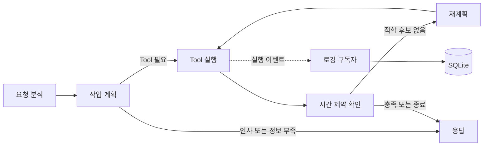

# Agent 설계 문서

- 실연동의 분석 노드는 GMS에 시각·기존 조건·사용 가능한 Tool 스키마를 넘긴다. GMS가 JSON으로 의도, 변경할 조건, Tool 순서, 판단 이유를 반환한다. Agent는 후보보다 상세를 먼저 조회하는 등 유효하지 않은 순서를 교정한다. 데모는 제한된 한국어 입력 해석과 합성 응답을 사용한다.
- 후보 조회에서 얻은 KOBIS 코드를 상세 Tool의 입력으로 전달한다. 지역 영화관은 후보와 독립적으로 조회한다. 개별 영화의 상세 호출은 최대 세 개까지 병렬 처리하고 결과를 후보 순서로 기록한다.
- 계산식은 `최종 시작 가능 시각 = 종료 마감 − 러닝타임 − 15분`이다. 이 값이 희망 시작 시각 이상이면 적합하다. 확인할 수 없는 러닝타임을 대체값으로 채우지 않는다. 날짜와 시간은 한국 표준시이며 관람일 내 시간 범위로 계산한다.
- 적합한 후보가 없으면 주간 순위와 이전 일별 순위에서 후보를 보충한다. 같은 실행에서 이미 판단한 후보와 조회한 영화관을 재사용한다. 3회가 지나면 종료한다. 후보 API 키 누락·인증·한도 오류는 즉시 종료한다.
- 관람 조건 네 가지를 브라우저 세션에 저장하고 사용자가 명시한 새 값만 반영한다. 실행 이벤트에는 순번, 시각, 종류, 구조화된 데이터가 들어간다. 구독자는 모델을 호출하지 않고 SQLite에 이벤트를 추가한다. 저장에 실패하면 응답에 `log_saved=false`를 표시한다.
- 계획 관리와 실행 로그 요청은 기존 브라우저 세션 쿠키로 접근 범위를 구분한다. 관람 시간 범위는 시작을 포함하고 종료를 제외하므로 서로 맞닿는 계획은 중복으로 계산하지 않는다.
